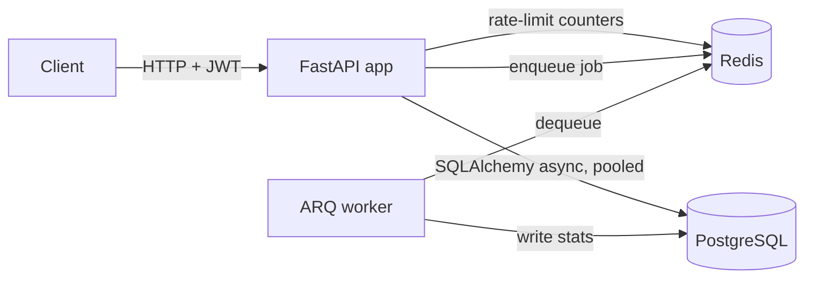

# Knowledge Base API

[](https://github.com/Revanth-Tatineni/knowledge-base-api/actions/workflows/ci.yml)

An async REST backend for a personal knowledge base: users write notes, tag them, and search
them with Postgres full-text search. After each write, a background worker computes word
count, reading time and keywords.

The goal is the parts of a backend that usually get skipped in demo projects: refresh-token
rotation with reuse detection, Redis rate limiting, background jobs, a standard response
envelope, migrations that CI checks, and tests that run against real Postgres and Redis.

**Stack:** FastAPI, SQLAlchemy 2 (async), PostgreSQL 16, Alembic, Redis, ARQ, Pydantic v2,
pytest, Docker, GitHub Actions

## Architecture



Each request flows down through the layers, and each layer only calls the one below it:

```
controllers   HTTP: parse input, call a service, wrap the result in SuccessResponse
  -> services       business rules, transaction boundaries
    -> repositories   SQL queries
      -> models/db      SQLAlchemy tables
```

## Project layout

```
app/
  main.py               app factory + `python -m app.main <command>` entrypoint
  cli.py                the shortcut commands (run, worker, migrate, test, build, up, ...)
  dependencies.py       current user, service wiring for controllers
  core/
    env.py              every environment variable, validated into one `settings` object
    logger.py           logging setup (text locally, JSON elsewhere) with request IDs
    exception.py        domain errors + global handlers -> standard error response
    db.py               engine + connection pool created at startup, session dependency
    redis.py            the one Redis pool: get/set JSON, counters, job enqueue
    rate_limiting.py    every API's rate limit in one table, Redis fixed-window limiter
    cors.py             CORS setup
    security.py         password hashing, JWT, refresh-token hashing
  middleware/
    request_context.py  request ID, access log, rate-limit headers
  models/
    response_model.py   GlobalResponse, SuccessResponse, ErrorResponse
    auth_model.py       request/response models per feature
    user_model.py
    note_model.py
    db/                 SQLAlchemy tables (user, note, tag, refresh_token)
  controllers/          auth, user, note, health
  services/             auth, note, text analysis
  repositories/         SQL queries
  workers/              ARQ tasks + worker settings
migrations/             Alembic
tests/
```

## Response format

Every response, success or error, has the same shape:

```json
{"status": 201, "message": "Note created", "data": {"id": "...", "title": "..."}, "errors": []}
```

```json
{"status": 404, "message": "Note not found", "data": null,
 "errors": [{"code": "NOT_FOUND", "field": null, "message": null}]}
```

Validation errors list each bad field:

```json
{"status": 422, "message": "Validation failed", "data": null,
 "errors": [{"code": "VALIDATION_ERROR", "field": "body.email", "message": "value is not a valid email address"}]}
```

## Features

- **Auth:** registration and login using the OAuth2 password flow (so Swagger's *Authorize*
  button works). Access tokens are short-lived JWTs (15 min). Refresh tokens are opaque and
  only their hashes are stored. Each refresh rotates the token; presenting a token that was
  already rotated out revokes that whole login session.
- **Notes:** CRUD with per-user ownership. Requests for another user's note return 404, so note
  IDs can't be probed. PATCH only changes the fields you send. Tags are normalized and
  deduplicated.
- **Search:** a weighted `tsvector` generated column with a GIN index. Title matches rank above
  body matches, and queries support `"phrases"`, `OR` and `-exclusions`.
- **Rate limiting:** one table in `core/rate_limiting.py` sets the limit for every API (per IP
  for auth, per user for everything else, with separate read and write budgets for notes). A
  test fails if any endpoint is missing a limit. Responses carry `X-RateLimit-*` headers, 429s
  include `Retry-After`, and the limiter fails open if Redis is down.
- **Background jobs:** ARQ worker. Note analysis runs after each text change, and a nightly
  cron job deletes expired refresh tokens.
- **Operations:** a pooled DB connection and one Redis pool shared across requests, logs that
  carry a request ID, `X-Request-ID` echoed on every response, and `/health/live` plus
  `/health/ready` endpoints.

## Run it

Everything in Docker:

```bash
python -m app.main up        # or: docker compose up --build -d
```

That starts Postgres, Redis, a one-off migration container, the API and the worker.

- API docs (Swagger): http://localhost:8000/docs
- Readiness: http://localhost:8000/health/ready

Local development (app on your machine, infrastructure in Docker):

```bash
uv sync                       # install dependencies into .venv
cp .env.example .env
uv run python -m app.main infra     # Postgres + Redis only
uv run python -m app.main migrate
uv run python -m app.main run       # API with auto-reload
uv run python -m app.main worker    # in a second terminal
```

All commands (`uv run python -m app.main --help`):

| Command | Does |
|---|---|
| `run` | start the API with auto-reload (default) |
| `worker` | start the background job worker |
| `migrate` | apply database migrations |
| `test` | run the test suite with coverage |
| `lint` | ruff + format check + mypy |
| `format` | auto-fix lint and formatting |
| `infra` | start only Postgres + Redis in Docker |
| `build` / `up` / `down` / `logs` | Docker image build, start, stop, follow logs |

## API

| Method | Path | Auth | Description |
|---|---|---|---|
| POST | `/api/v1/auth/register` | - | Create an account |
| POST | `/api/v1/auth/login` | - | Get access + refresh tokens (form: `username`, `password`) |
| POST | `/api/v1/auth/refresh` | - | Swap a refresh token for a new pair |
| POST | `/api/v1/auth/logout` | - | Revoke the refresh-token family |
| GET / PATCH | `/api/v1/users/me` | Bearer | Read / update profile |
| POST | `/api/v1/notes` | Bearer | Create a note |
| GET | `/api/v1/notes?limit&offset&tag&q` | Bearer | List, filter by tag, full-text search |
| GET / PATCH / DELETE | `/api/v1/notes/{id}` | Bearer | Read / partial update / delete |
| GET | `/health/live`, `/health/ready` | - | Liveness / readiness |

## Tests

```bash
uv run python -m app.main infra
uv run python -m app.main test
```

52 tests, about 98% coverage. They run against a real Postgres and Redis rather than SQLite or
fakes, because the features under test (full-text search, `ON CONFLICT`, row locks, Redis
expiry) behave differently or don't exist in the substitutes.

CI runs four groups of checks:

- lint: `ruff check`, `ruff format --check`, `mypy`
- migrations: `alembic upgrade head`, then `alembic check` (fails if the models and migrations
  have drifted apart), then a full downgrade/upgrade round trip
- the test suite, with coverage
- a Docker build

## What I'd add next

- Keyset (cursor) pagination for deep pages
- Email verification and password reset
- A transactional outbox, so a job can never be lost between the DB commit and the enqueue
- Semantic search over notes (embeddings + pgvector), which turns this into a RAG backend
