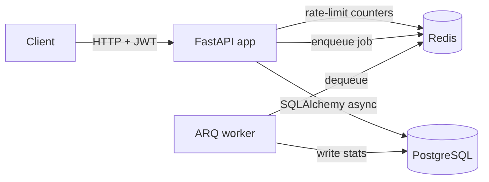

# Knowledge Base API

[](https://github.com/<your-github-username>/knowledge-base-api/actions/workflows/ci.yml)

An async REST backend for a personal knowledge base: users write notes, tag them, and search
them with Postgres full-text search. After each write, a background worker computes word
count, reading time and keywords.

The goal is the parts of a backend that usually get skipped in demo projects: refresh-token
rotation with reuse detection, Redis rate limiting, background jobs, migrations that CI checks,
and tests that run against real Postgres and Redis.

**Stack:** FastAPI · SQLAlchemy 2 (async) · PostgreSQL 16 · Alembic · Redis · ARQ · Pydantic v2 ·
pytest · Docker · GitHub Actions

## Architecture



The code is layered, and each layer only calls the one below it:

```
routes (HTTP: parse, validate, status codes)
  └─ services (business rules, transactions)
       └─ repositories (SQL queries)
            └─ models (SQLAlchemy tables)
```

## Features

- **Auth:** registration and login using the OAuth2 password flow (so Swagger's *Authorize*
  button works). Access tokens are short-lived JWTs (15 min). Refresh tokens are opaque and
  only their hashes are stored. Each refresh rotates the token; presenting a token that was
  already rotated out revokes that whole login session.
- **Notes:** CRUD with per-user ownership. Requests for another user's note return 404, so note
  IDs can't be probed. PATCH only changes the fields you send. Tags are normalized and
  deduplicated.
- **Search:** a weighted `tsvector` generated column with a GIN index. Title matches rank above
  body matches, and queries support `"phrases"`, `OR` and `-exclusions`.
- **Rate limiting:** fixed-window counters in Redis. Login and register are limited per IP;
  everything else is limited per user. Every response carries `X-RateLimit-*` headers, 429s
  include `Retry-After`, and the limiter fails open if Redis is down.
- **Background jobs:** ARQ worker. Note analysis runs after each text change, and a nightly
  cron job deletes expired refresh tokens.
- **Operations:** JSON logs carrying a request ID, `X-Request-ID` echoed on every response, the
  same error format everywhere, and `/health/live` plus `/health/ready` endpoints.

## Run it

```bash
docker compose up --build
```

That starts Postgres, Redis, a one-off migration container, the API and the worker.

- API docs (Swagger): http://localhost:8000/docs
- Readiness: http://localhost:8000/health/ready

### Local development (without containerizing the app)

```bash
uv sync                                  # install deps into .venv
docker compose up -d db redis            # just the infrastructure
cp .env.example .env
uv run alembic upgrade head
uv run uvicorn app.main:app --reload     # API
uv run arq app.worker.settings.WorkerSettings   # worker, in a second terminal
```

## API

| Method | Path | Auth | Description |
|---|---|---|---|
| POST | `/api/v1/auth/register` | – | Create an account |
| POST | `/api/v1/auth/login` | – | Get access + refresh tokens (form: `username`, `password`) |
| POST | `/api/v1/auth/refresh` | – | Swap a refresh token for a new pair |
| POST | `/api/v1/auth/logout` | – | Revoke the refresh-token family |
| GET / PATCH | `/api/v1/users/me` | Bearer | Read / update profile |
| POST | `/api/v1/notes` | Bearer | Create a note |
| GET | `/api/v1/notes?limit&offset&tag&q` | Bearer | List, filter by tag, full-text search |
| GET / PATCH / DELETE | `/api/v1/notes/{id}` | Bearer | Read / partial update / delete |
| GET | `/health/live`, `/health/ready` | – | Liveness / readiness |

Errors always use this shape:

```json
{"error": {"code": "not_found", "message": "Note not found", "request_id": "9fdf47de..."}}
```

## Tests

```bash
docker compose up -d db redis
uv run pytest --cov
```

43 tests, about 98% coverage. They run against a real Postgres and Redis rather than SQLite or
fakes, because the features under test (full-text search, `ON CONFLICT`, row locks, Redis
expiry) behave differently or don't exist in the substitutes.

CI runs four groups of checks:

- lint: `ruff check`, `ruff format --check`, `mypy`
- migrations: `alembic upgrade head`, then `alembic check` (fails if the models and migrations
  have drifted apart), then a full downgrade/upgrade round trip
- the test suite, with coverage
- a Docker build

## Project layout

```
app/
  api/          routes, dependencies (auth, sessions, rate limits)
  core/         config, security, errors, logging, rate limiter
  db/           declarative base, engine/session factory
  models/       SQLAlchemy models
  schemas/      Pydantic request/response models
  repositories/ database queries
  services/     business logic
  worker/       ARQ tasks and worker settings
migrations/     Alembic
tests/
```

## What I'd add next

- Keyset (cursor) pagination for deep pages
- Email verification and password reset
- A transactional outbox, so a job can never be lost between the DB commit and the enqueue
- Semantic search over notes (embeddings + pgvector), which turns this into a RAG backend
